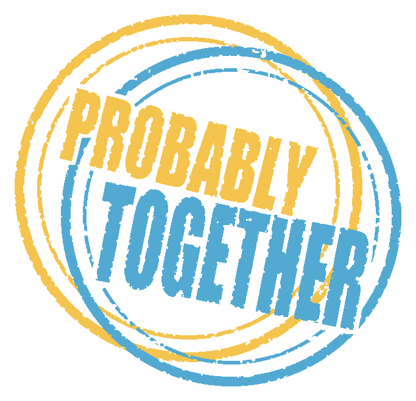

<p align="center">
  
</p>

<p align="center">
  Online co-op for Probably Stolen: 2 to 4 players run one shop together.
</p>

<p align="center">
  <a href="../../releases"><b>Download the Latest Release</b></a>
</p>

## Features

- **Host from the main menu** - "Host a shop" turns your own game into the server, on the game's
  own load and new game screens. Pick a saved shop or start a new one with a scenario, perks and
  difficulty. Hosted shops live in their own folder and never show up in single player.
- **A place of your own** - every player keeps a seat in the shop, a storage bay only they can
  open, a trade of their own with its kit, machines and scripted visitors, and their own starting
  perks, wounds and health.
- **One shop, everyone at once** - items, the counter, customers, negotiation, machines,
  chemistry, security and the network stay in step on every copy. Acting on a customer takes the
  counter; you see what other players are dragging under their hand.
- **Night outings** - players go out one by one at night (the dump, Dr. Jackson's, the
  Commissary) while the others keep the shop running.
- **The night without a reload** - every copy goes through the night itself and checks it against
  the host. When it matches, the morning arrives in place, windows and all; when it doesn't, the
  copy reloads the shop as a fallback.
- **A ledger of whose deals were whose** - money, standing and specializations per player.
- **Leave and come back** - step out as host without closing the shop, rejoin into your seat, or
  let a trade or a player leave the shop for good.
- **Voice chat** built in, and no calls to third-party services: the only connection is to the
  host you choose.

## Install

1. Download `ProbablyTogether-<version>.zip` from the newest entry in [Releases](../../releases).
2. Unzip it into your Probably Stolen folder, so `Mods\ProbablyTogether` sits next to the game.
   It replaces an older version.
3. Every player in a shop needs the same version.

To play, one player picks **Host a shop** on the main menu and the others use **Join server**
with the host's address and password.

## Building from source

Requires the .NET SDK 9 and Probably Stolen installed.

```
cd src
dotnet build -c Release
```

- `-c Ship` builds the player version without the test bots; releases are this build.
- The game is found in the default Steam folder; pass `-p:GameManaged="<game>\Probably Stolen_Data\Managed"`
  if yours is elsewhere. See [src/BUILD.md](src/BUILD.md).
- Install by copying `ProbablyTogether.dll` and `manifest.xml` into `<game>\Mods\ProbablyTogether\`
  with the game closed.

## How it stays in sync

The host's game is the server. A player's action goes to the server, which runs the game's own
code for it under shared dice and sends the result to every copy, so every copy runs the same
game code from the same state. Each copy compares a fingerprint of the shop with the server's and
catches up by reloading the shop when they differ. [CHANGELOG.md](CHANGELOG.md) lists every version.

## License

[MIT](LICENSE). Based on the upstream mod 0.2.8 by
HumanGenome (MIT). The bundled Concentus voice codec is under the BSD 3-clause license (see
[LICENSE-Concentus.txt](LICENSE-Concentus.txt)). Game names and data aren't covered by either;
see the disclaimer below.

## Disclaimer

Probably Together is a fan-made mod and isn't affiliated with or endorsed by Questing Goose
Studio or tinyBuild. Probably Stolen and all of its names and game data are the property of
their respective owners.
